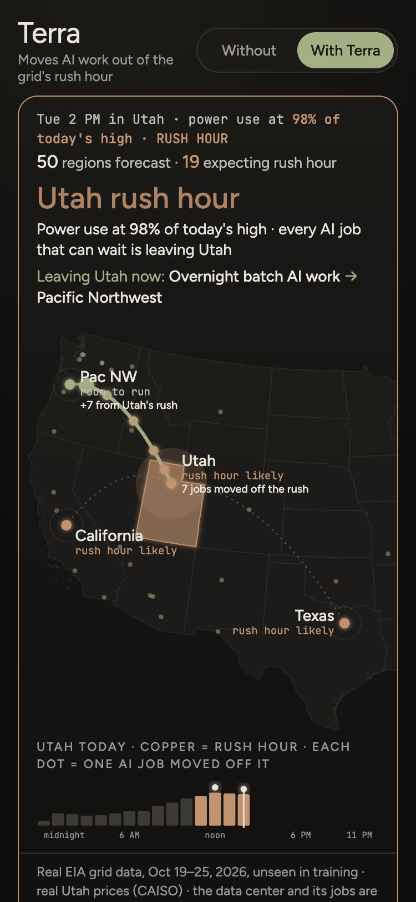
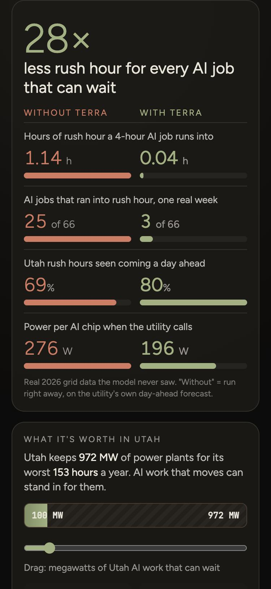
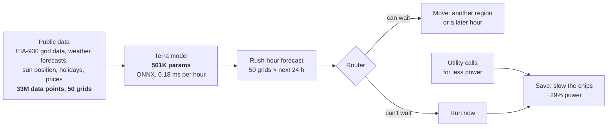

<div align="center">

# Terra

**Power plants can't move. AI work can.**

Terra forecasts every US power grid's rush hour a day ahead and moves AI work around it, automatically.

[](https://terra.granitetait.com)
[](https://terra-live.granitetait.com/deck/)
[](deck/Terra-slides.pdf)
[](#results)
[](#built-for-torus)
[](LICENSE)

<table>
<tr>
<td></td>
<td></td>
</tr>
<tr>
<td align="center"><sub>A utility call in Utah. Terra slows its chips 29% and sends work to the Pacific NW, skipping California's rush hour.</sub></td>
<td align="center"><sub>Without vs with Terra, on real 2026 grid data the model never saw.</sub></td>
</tr>
</table>

**[Open the live demo on your phone →](https://terra.granitetait.com)**

</div>

---

## The problem

- **Grids are built for their worst hour.** In 2025 the top 10% of Utah's grid, **972 MW**, was needed for only
  **153 hours**, 1.7% of the year. At $728–1,969 per kW for a new gas peaker, that's **$0.7–1.9 billion** of plants
  that sit idle 98% of the time.
- **AI is making that hour worse.** Data centers are the biggest new source of demand, and every load is treated as
  fixed.
- **The forecasts miss.** This October, the utility's own day-ahead forecast put Utah's peak at 6 PM. It came at
  1 PM.

## The idea

Grids peak at different hours: Texas around 4 PM, Utah at 5, California and the Pacific Northwest at 7 (Utah time).
In **85%** of Utah's 2026 rush hours, another grid had room to spare. Most AI work, like training and batch jobs, can
wait a few hours or run somewhere else. So Terra does three things every hour:

| | | |
|---|---|---|
| **1. Predict** | When will each of 50 US grids hit its rush hour, over the next 24 hours? | a 561K-parameter model, trained at home on one RTX 4080 |
| **2. Move** | Send work that can wait to a calmer region or a later hour, if there's room for the whole run | the same routing rule in the server and in the browser |
| **3. Save** | When the utility calls for less power, slow the chips that can't move | 29% less power for 6% less speed, measured |



## Results

All scores are on held-out 2026 data the model never saw. Every number here and on the slides comes from
[`deck/numbers.json`](deck/numbers.json), which `deck/make_numbers.py` builds from the test results in `out/` and the
hourly grid table (`data/train/hourly_v2.parquet`, 117 MB, rebuilt by `train/build_dataset.py`). None are typed in by
hand. The [model card](out/v2/MODEL_CARD.md) has the full breakdown, including where Terra doesn't beat the utility. "Without" means running the job right away in Utah,
on the utility's own day-ahead forecast.

| | Without Terra | With Terra | |
|---|---:|---:|---|
| Rush hour a 4-hour AI job runs into | 1.14 h | **0.04 h** | **28× less** |
| AI jobs that ran into rush hour, one real week | 25 of 66 | **3 of 66** | |
| Utah rush hours seen coming a day ahead | 69% | **80%** | |
| Rush-hour forecast error (Brier, all 50 grids) | 0.071 | **0.050** | **29% lower** |
| Power per AI chip when the utility calls | 276 W | **196 W** | −29%, for 6% less speed |
| Sudden power jump at a 1 MW AI site (simulated) | 813 kW | **16 kW** | 52× smaller |

### Right-sized on purpose

Terra doesn't burn power to save power. Energy per forecast, measured on the same MacBook:

| Model | Parameters | Energy per forecast | Fewer errors than the utility |
|---|---:|---:|---:|
| **Terra (shipped)** | **561K** | **1×** | **29%** |
| Transformer | 4.8M | 590× | 31% |
| Fine-tuned LLM (Qwen3-4B + LoRA) | 4B | 690,000× | 3% |

A full year of forecasts for all 50 grids takes about **20 joules**.

### What it's worth

Rocky Mountain Power's Wattsmart Business program pays **$100 per kW a year** for load that can be cut at peak.
That makes **100 MW** of AI work that can wait worth about **$10 million a year**, and it stands in for **$73–197
million** of peak plants that wouldn't need to be built.

## Built for Torus

Torus's control software, Lasso, already routes grid events to two assets. Terra adds a third, with nothing new to
build:

| | Torus Spin | Torus Pulse | **Terra** |
|---|---|---|---|
| Responds in | milliseconds | hours | a day ahead |
| What it moves | sudden swings (flywheel) | the long peak (battery) | **the load itself** |

Terra also starts jobs a few chips at a time, so there's less sudden swing for Spin to catch.

## Repository layout

| Path | What |
|---|---|
| [`train/`](train/) | Data pipeline and training (Python, PyTorch). `build_dataset.py` turns 50 grids × 6 kinds of public data into 1.04M examples; `train.py` trains the model and exports ONNX; `train_big.py` fine-tunes the 4B comparison model |
| [`out/v2/`](out/v2/) | **The shipped model**: `mycelium.onnx` (561K parameters, 2.2 MB), its test metrics and [model card](out/v2/MODEL_CARD.md). Terra was called Mycelium during the build, so some file names still use it |
| [`out/v3_candidate/`](out/v3_candidate/) | The 4.8M-parameter transformer: about 2% better, 590× the energy, so not shipped |
| [`router/`](router/) | TypeScript server: runs the model, routes jobs (`decide.ts`), tracks room at each site (`capacity.ts`), staggers starts (`surge.ts`), serves the live map and deck |
| [`web/`](web/) | The phone demo: a replay of a held-out week, with routing running in the browser on the same rule as `decide.ts` |
| [`demo/`](demo/) | The stage live map and the GPU demand-response agent (RTX 4080 clock lock) |
| [`deck/`](deck/) | The slides, the 3-minute script, and `numbers.json`, where every number on the slides comes from |
| [`data/`](data/) | The replay week the demos run on, and an index of every real dataset and the number it backs |

## Run it

```bash
# Router, live map and deck at http://localhost:8787 (slides at /deck/). Node 24+.
npm --prefix router install
npm --prefix router start

# Phone demo: any static server
python3 -m http.server -d web 8798

# Rebuild the phone demo's data after a retrain or replay change
node router/src/export-web.ts
```

Retraining: `pip install -r requirements.txt` (Python 3.13, pinned to the training environment). It needs the full dataset (`data/train/dataset_v2.npz`, 2.5 GB, not in the repo). Rebuild it with
`train/fetch_weather.py` and `train/build_dataset.py`, then run
`OUT=out/v2 PYTHONPATH=train python train/train.py data/train/dataset_v2.npz` (about 80 seconds on an RTX 4080).
The 4B fine-tune's weights (8 GB) aren't in the repo either; `train/train_big.py` rebuilds them from Qwen3-4B.

## Data sources

| Source | Used for |
|---|---|
| [EIA-930](https://www.eia.gov/electricity/gridmonitor/) hourly grid data | demand, generation mix and the utility's day-ahead forecast, 50 grids |
| [EIA-860M](https://www.eia.gov/electricity/data/eia860m/) | planned Utah power plants |
| [Open-Meteo](https://open-meteo.com/) archived forecasts | the weather each grid expected, one city per grid |
| CAISO OASIS | Utah's real-time wholesale price (PacifiCorp East) |
| Rocky Mountain Power tariffs and Utah PSC filings | Wattsmart Business demand-response price and real past calls |
| Alibaba 2026 GPU cluster trace (155,410 GPUs) | the mix of AI jobs: what can wait and what can't |

## What's real and what's simulated

**Real:** EIA grid data, archived weather forecasts, Utah prices and tariffs, the GPU's measured power, the model
and every one of its scores. **Simulated, and labeled that way in the demos:** the AI data centers, their size and
in-house load, the 1 MW site in the surge number, and the utility's call in the replay week (Tue Oct 20, noon–2 PM,
that week's highest demand). "Rush hour" means demand at or above 95% of that day's high.

---

<div align="center">
<sub>Built by <b>Granite Tait</b> for the Hard Tech Hackathon, Salt Lake City, October 2026. MIT licensed.</sub>
</div>
